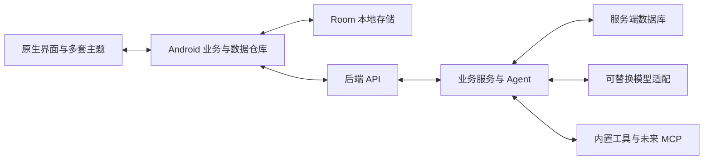

# Android 角色应用总体设计

本项目采用 Android 原生客户端与独立后端。角色聊天是入口，角色可以通过 Agent 调用工具完成任务。界面、业务规则、数据保存、通信方式与模型服务分别设计，使多套主题和页面能够复用能力。

状态：阶段 4A 已实现后端持久化聊天、模拟与 OpenAI 兼容文本适配，外部供应商联调尚未进行。Android、Agent、客户端同步和 MCP 尚未实现。当前运行范围见 [阶段报告](stage-reports/04a-model-adapter-and-secrets.md)。

## 本阶段的设计选择

| 范围 | 选择 | 原因 |
| --- | --- | --- |
| Android | Kotlin 与 Jetpack Compose | 原生界面与系统能力接入 |
| 手机存储 | Room 管理 SQLite，简单设置单独保存 | 页面快速读取、本地记录和待发送状态 |
| 服务端 | Python 与 FastAPI，先做单个模块化服务 | 延续原型已有技术方向，方便定义接口和逐步验证 |
| 服务端存储 | 开发阶段使用独立 SQLite 文件 | 先验证模型与事务，无需先部署数据库服务 |
| 后续部署数据库 | 多实例或写入负载增加时评估 PostgreSQL | 届时验证迁移与并发，不承诺只改连接地址 |
| 通信 | 首版 HTTP JSON 与 SSE 事件流 | 查询与流式回复分别处理，业务事件不绑定传输方式 |
| Agent | 在线任务由后端执行，客户端保留轻量协调与本地工具边界 | 每次任务明确执行归属，避免两端同时调用模型或工具 |

工具版本在对应实现阶段核对并固定。正式账号认证、模型供应商和产品名称尚未选定。

## 两端如何协作

客户端主要读取本地仓库提供的业务状态；后端接口结果写入本地后驱动页面更新。服务端已确认记录用于账号下多设备对齐，本地草稿和未确认操作另有状态。两端通过接口交换数据，不直接连接或复制对方的数据库文件。

Room 不会自动完成云同步。数据库记录、网络响应和 UI 状态分别转换，简单主题设置不必放进聊天数据库。图片、音频等资源放在文件或对象存储中，数据库保存资源标识和元信息。

具体存储范围见 [数据模型](data-model.md)，通信约定见 [接口草案](../contracts/api-v1.md)。

## 角色与 Agent 的边界

角色描述人设、表达方式、公开简介、资源引用和允许使用的能力。Agent 执行机制可以复用，用户、角色、会话和任务上下文必须隔离。公开简介与服务端私有提示词分别管理。

首个在线流程由服务端负责组装上下文、调用模型、执行工具及保存结果。客户端负责输入、状态协调、停止请求和展示。客户端轻量 Agent 边界保留，用于后续设备本地任务，不在第一版重复建设另一套云端执行循环。

每次执行有固定的执行归属。首版服务端任务标记为 `executor = server`；未来纯本地任务使用独立的本地执行接口与记录，不直接作为服务端任务上传执行。涉及设备工具的跨端委派需要独立协议，尚未纳入首版。

任务停止是尽力终止后续工作，已完成的外部操作不会自动撤销。工具的真实执行结果与角色生成的台词分别记录。

## Android 模块

以下均为预留目录，尚未声明为 Gradle 模块。先明确职责，再按实施阶段接入构建。

| 目录 | 职责 | 依赖约束 |
| --- | --- | --- |
| `android/app` | 启动、导航与依赖组装 | 选择实际启用的实现 |
| `core/domain` | 客户端实体、仓库接口、业务操作和执行接口 | 不依赖 Compose、数据库或供应商 SDK |
| `core/data` | 本地存储、远程数据源、待发送状态与对齐 | 依赖 `domain`、`network` |
| `core/network` | HTTP、SSE 与未来传输实现 | 不包含角色和页面逻辑 |
| `core/model` | 可选直连或本地模型适配预留 | 首版在线模型由后端管理，暂不实现 |
| `core/agent` | 轻量执行协调与本地任务预留 | 依赖 `domain`，不复制在线执行循环 |
| `core/tools` | 设备本地工具预留 | 通过接口按需接入 Android 能力 |
| `core/designsystem` | 主题与共享 Compose 组件 | 不依赖模型和存储实现 |
| `feature/characters` | 角色列表与资料 | 依赖 `domain`、`designsystem` |
| `feature/chat` | 会话、消息和任务的不同布局 | 依赖 `domain`、`designsystem` |
| `feature/settings` | 主题与连接设置 | 通过业务接口读写配置 |
| `integrations/mcp` | 未来设备侧 MCP 适配 | 首个远程 MCP 接入在后端实现 |

页面不直接构造 SQL 或模型请求。不同布局可以有不同临时界面状态，发送、保存与任务执行规则仍然复用。

## 服务端模块

服务端放在根目录 `backend/`，与 Android 独立构建和运行。先使用一个进程，按职责分模块。

| 目录 | 职责 |
| --- | --- |
| `backend/src/character_app/api` | 请求校验、当前用户解析、响应与事件流适配 |
| `backend/src/character_app/domain` | 实体、状态规则与仓库及模型工具接口 |
| `backend/src/character_app/application` | 会话、消息、任务的业务操作与 Agent 编排 |
| `backend/src/character_app/adapters/storage` | 数据库仓库实现与事务 |
| `backend/src/character_app/adapters/models` | 模拟服务与真实模型供应商适配 |
| `backend/src/character_app/adapters/tools` | 服务端内置工具 |
| `backend/src/character_app/adapters/mcp` | 未来 MCP 工具发现与调用适配 |
| `backend/migrations` | 后续数据库迁移脚本 |

`domain` 不依赖 FastAPI 与数据库驱动；`application` 使用领域接口；适配层实现接口，后续入口负责组装。API 层调用业务操作，不在路由中直接拼接 SQL 或模型提示词。

两端共享接口语义，不强行共享 Kotlin 与 Python 源文件。实现接口后由 FastAPI 导出 OpenAPI，并核对其与草案的一致性。

## 可替换能力

- 通信模块处理连接与协议；模型模块处理供应商格式。替换传输以服务端支持为前提。
- 模型转换为统一文本、完成、错误与工具请求事件。工具调用等能力显式声明，不假设每个模型都支持。
- 内置工具与未来 MCP 工具遵守共同调用接口。资源与提示模板按需独立扩展，当前预留不代表完整 MCP 支持。
- 首版可拔插是开发时替换实现、运行时选择已集成实现。在线下载任意执行插件不在当前范围。

## 请求与执行生命周期

客户端先保存待发送消息，使用稳定请求标识提交。服务端在一个事务中创建用户消息、待生成回复和任务；重复请求返回同一次执行。客户端用服务端消息标识更新本地记录。

任务执行与某一次 SSE 连接分离。断开页面只停止订阅，明确的停止操作才请求取消。首版为单进程开发服务；进程中断后将遗留任务标记失败，不自动重放可能产生外部影响的操作。持续运行、持久工作队列与多实例执行在后续设计。

每个会话首版只接受一个未结束任务。事件先保存再发布，客户端可按序号恢复和去重。具体状态见接口草案。

## 原型参考与范围

参考目录为 `E:\MYcode\IOSH5DEMO`，仅用于读取原型与关键源码，未修改或启动原型服务。原型包含 HTML、Node.js 和 FastAPI 两套服务实现；本项目选择 FastAPI 路线，不整体复制两套实现。

背景图、简介、动作描写、台词与语音入口用于梳理内容结构。原型预设对白与实际会话消息分开建模，不将预设分页结构直接当作聊天记录。

账号系统、语音生成、社区、推荐、主动消息、复杂长期记忆和完整 MCP 接入分阶段实现。第一条工具流程为角色整理并保存笔记。

## 设计依据

Room 提供 SQLite 访问抽象，本地与网络数据源由应用数据仓库协调。[Room](https://developer.android.com/training/data-storage/room)、[Android 离线数据架构](https://developer.android.com/topic/architecture/data-layer/offline-first)

FastAPI 支持基于类型定义接口校验与 OpenAPI 文档。选择它是结合原型与实施成本的工程判断。[FastAPI 功能](https://fastapi.tiangolo.com/features/)

SQLite 适合嵌入式与部分服务端场景，高写入并发或多服务器场景需要重新评估。本阶段选型不代表正式部署已验证。[SQLite 使用场景](https://www.sqlite.org/whentouse.html)
